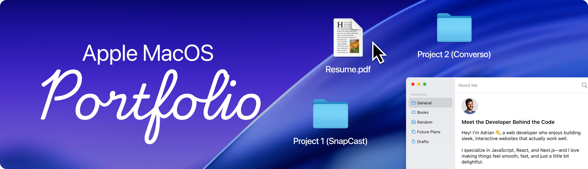

<div align="center">
  <br />
  
  <br />

  <div>


  </div>

  <h3 align="center">macOS Portfolio</h3>

  <p align="center">My developer portfolio, built as a macOS desktop that runs in the browser, with a Caribbean touch from the Dominican Republic.</p>
</div>

## 📋 <a name="table">Table of Contents</a>

1. ✨ [Introduction](#introduction)
2. ⚙️ [Tech Stack](#tech-stack)
3. 🔋 [Features](#features)
4. 🗂️ [Project Structure](#project-structure)
5. 🤸 [Quick Start](#quick-start)
6. 🚀 [Deployment](#deployment)
7. 🎨 [Customization](#customization)
8. 🙌 [Credits](#credits)
9. 📬 [Contact](#contact)

## <a name="introduction">✨ Introduction</a>

Instead of a static resume page, this portfolio works like a small operating system. Visitors can browse my projects in Finder, read my latest LinkedIn posts in Safari, check my skills in Terminal, and view or download my resume in English or Spanish.

On a phone, the same content becomes an iOS-style home screen with full-screen apps.

It is a single-page React application with no backend of its own. Content lives in plain JavaScript files, and the LinkedIn feed comes from an embedded Elfsight widget.

## <a name="tech-stack">⚙️ Tech Stack</a>

- **[React 19](https://react.dev)** for the interface and components.
- **[Vite 8](https://vite.dev)** for the development server and production build.
- **[Tailwind CSS 4](https://tailwindcss.com)** for styling, dark mode and responsive variants.
- **[GSAP](https://gsap.com)** for the Dock, window and welcome animations, and for dragging windows.
- **[Zustand](https://zustand.docs.pmnd.rs)** with **[Immer](https://immerjs.github.io/immer)** for window, location, language and music state.
- **WebGL** for the water animation on the wallpaper.
- **[React PDF](https://github.com/wojtekmaj/react-pdf)** for the resume viewer.
- **[Elfsight](https://elfsight.com/linkedin-feed-widget)** for the LinkedIn feed.
- **[Radix UI](https://www.radix-ui.com)**, **[Lucide](https://lucide.dev)**, **[Day.js](https://day.js.org)** and **[React Tooltip](https://react-tooltip.com)** for the language menu, icons, menu bar date and Dock labels.

## <a name="features">🔋 Features</a>

👉 **Window Management**: Open, close, focus, drag and minimize windows, or use the green button or a double-click on the title bar for full screen.

👉 **Full Screen**: As on a Mac, the window fills the screen, and the menu bar and Dock appear when the cursor reaches the screen edge.

👉 **Magnifying Dock**: Icons grow with the cursor, and a dot marks open apps and playing music.

👉 **Animated Wallpaper**: A WebGL shader moves the water of a Caribbean beach in a continuous loop, with a separate photo for portrait screens.

👉 **Animated Welcome**: GSAP text animation that reacts to the cursor.

👉 **Finder**: Browse projects, personal files, the resume and the trash.

👉 **Safari**: Shows my 3 most recent LinkedIn posts, updated automatically.

👉 **Music**: A Spotify-style player with 3 licensed tracks that keeps playing in the background.

👉 **Photos**: A gallery that opens images in a preview window.

👉 **Contact**: GitHub, WhatsApp, Gmail and LinkedIn links.

👉 **Terminal**: My tech stack, shown as command output.

👉 **Resume Viewer**: A PDF viewer with download that follows the selected language.

👉 **English and Spanish**: Detects the browser language, and the menu bar switch translates the interface and changes the resume. Main Finder folders are translated too, while project and file names keep their original language.

👉 **Light and Dark Mode**: Switch from the menu bar.

👉 **Mobile Experience**: An iOS-style layout for phones, including landscape.

👉 **Reduced Motion**: The wallpaper stays still for visitors who prefer less animation, or if the browser has no WebGL.

## <a name="project-structure">🗂️ Project Structure</a>

```text
public/
├── files/            Resume PDFs (English and Spanish)
├── icons/, images/   Icons, photos and wallpapers
├── music/            Audio tracks
└── readme/           README banner
src/
├── components/       Navbar, Dock, wallpaper, music player, language and theme
│   ├── mobile/       iOS-style pieces
│   └── ui/           Shared UI primitives
├── constants/        Portfolio content and Spanish translations
├── hoc/              WindowWrapper (desktop) and MobileWindowWrapper
├── lib/              Helpers, including the mobile viewport check
├── store/            Zustand stores: window, location, language and music
└── windows/          One component per app
    └── mobile/       Mobile version of each app
```

## <a name="quick-start">🤸 Quick Start</a>

Follow these steps to set up the project locally on your machine.

**Prerequisites**

Make sure you have the following installed on your machine:

- [Git](https://git-scm.com/)
- [Node.js](https://nodejs.org/en) 20.19+ or 22.12+
- [npm](https://www.npmjs.com/) (Node Package Manager)

**Cloning the Repository**

```bash
git clone https://github.com/hjmnz-dev/MacOS_Portfolio.git
cd MacOS_Portfolio
```

**Installation**

Install the project dependencies using npm:

```bash
npm install
```

**Running the Project**

```bash
npm run dev
```

Open [http://localhost:5173](http://localhost:5173) in your browser to view the project.

## <a name="deployment">🚀 Deployment</a>

The site is hosted on [Cloudflare Pages](https://pages.cloudflare.com), connected to this repository:

- Every push to  builds and publishes the site.
- Every other branch gets its own preview URL.
- If a build fails, the last working version stays online.

| Setting | Value |
| --- | --- |
| Build command |  |
| Output directory |  |
| Security headers |  |

No environment variables are needed. Do not expose  to the internet: the development server serves the source code.

## <a name="customization">🎨 Customization</a>

| To change | Edit |
| --- | --- |
| Bio, tech stack and social links | `src/constants/index.js` |
| Projects and files in Finder | `locations` in `src/constants/index.js` |
| Gallery images | `gallery` in `src/constants/index.js` |
| Music | `musicTracks` in `src/constants/index.js`, with the audio in `public/music/` |
| LinkedIn feed | `linkedInFeed` in `src/constants/index.js` |
| Resume | `public/files/`, referenced by `resumeFiles` in `src/constants/index.js` |
| Spanish text | `src/constants/translations.js` |
| Wallpaper | `public/images/` and `src/components/AnimatedWallpaper.jsx` |

## <a name="credits">🙌 Credits</a>

- **Wallpaper**: Generated with AI.
- **Music**: "Gymnopedie No. 1", "Enchanted Valley", "Lobby Time" Kevin MacLeod ([incompetech.com](https://incompetech.com)). Licensed under Creative Commons: [By Attribution 4.0 License](http://creativecommons.org/licenses/by/4.0/).

## <a name="contact">📬 Contact</a>

**Hamsell Jiménez**

- [GitHub](https://github.com/hjmnz-dev)
- [LinkedIn](https://www.linkedin.com/in/hamselljimenez)
- [hamselljimenez@gmail.com](mailto:hamselljimenez@gmail.com)
